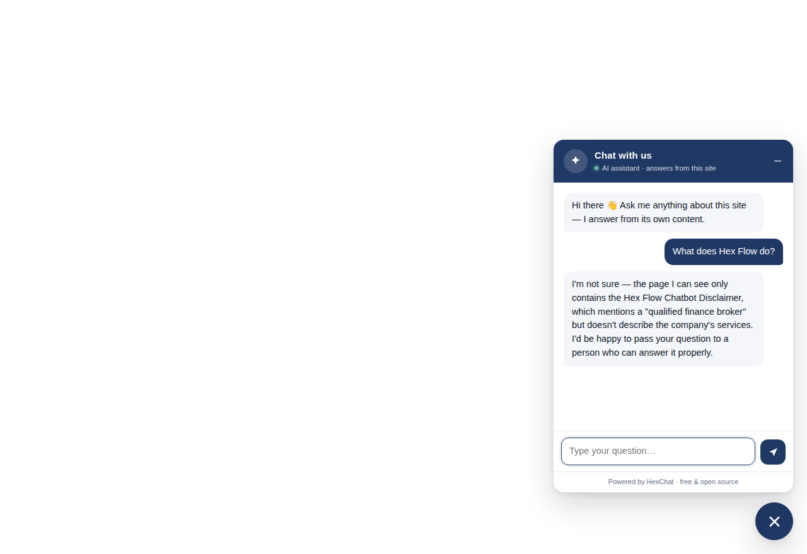

# HexChat

An AI chat widget for WordPress that answers from **your own pages** — free, open source, and bring-your-own API key.

No account with us. No proxy. No subscription. You paste a key from OpenAI, OpenRouter, Groq, Ollama, Anthropic or Gemini, and the plugin talks to that provider directly.



## Why it exists

Most chat plugins are either a canned-question box dressed up as AI, or a paid SaaS that owns your traffic. HexChat is a plain WordPress plugin: your content, your key, your database, your data.

## Features

- **Modern widget** — launcher bubble, slide-up panel, streaming-style typing indicator, mobile-first, rendered in a shadow root so themes cannot break it.
- **Grounded answers** — retrieval over your published pages and posts. If the site does not say it, the assistant does not claim it.
- **Human handover** — when confidence is low, it says so and offers an email contact.
- **Encrypted key storage** — libsodium secretbox with a key derived from your `AUTH_KEY`. Never rendered back, never sent to the browser.
- **Cost guardrails** — per-minute rate limit, daily cap per visitor, message length cap.
- **Transcripts with retention** — local table, 30 days by default, IPs stored only as salted hashes.
- **"What visitors ask" panel** — the questions it could not answer well are the pages you should write next.

## Requirements

- WordPress 6.0+
- PHP 7.4+
- An API key from one supported provider

## Install

```bash
cd wp-content/plugins
git clone https://github.com/hexf1ow/hexchat.git
```

Activate **HexChat**, then go to **Settings → HexChat**, pick a provider, paste your key, choose a model and tick *Show the chat widget on the site*.

## Providers

| Provider | Value | Notes |
| --- | --- | --- |
| OpenAI-compatible | `openai` | Covers OpenAI, OpenRouter, Groq, Together, LM Studio, Ollama `/v1`, vLLM |
| Anthropic | `anthropic` | `claude-3-5-haiku-latest` and newer |
| Google Gemini | `gemini` | `gemini-2.0-flash` and newer |

## How answers are built

1. The visitor's question is reduced to search terms (stopwords removed).
2. Published pages and posts are split into passages and scored with a small BM25-style ranking.
3. The best passages are appended to your system prompt as `CONTEXT`.
4. The model is instructed to answer **only** from that context, in under 90 words, escalating anything it cannot ground.

v0.1 is deliberately dependency-free: no embeddings, no vector database, no external service. It runs on cheap shared hosting. Embeddings are planned as an option, not a requirement.

## Security posture

- API key encrypted at rest; decrypted only in memory for the outbound request.
- All model calls happen server-side through `POST /wp-json/hexchat/v1/chat`.
- `wp_rest` nonce check on every request, plus per-IP rate and daily caps.
- No raw IP stored — salted SHA-256 only.
- Uninstall drops options and the transcript table.

## Roadmap

- [ ] Streaming responses (SSE)
- [ ] Optional embeddings for large sites
- [ ] Multi-language UI strings
- [ ] WooCommerce product grounding
- [ ] WP-CLI index rebuild

## Licence

GPL-3.0-or-later. Use it, fork it, ship it.
